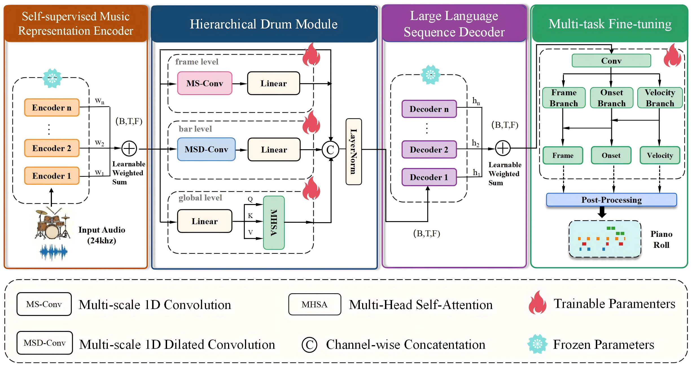

# Hi-Drum

**A Framework for Drum Transcription Based on Self-Supervised Music Representations**

Official code and demo for the Hi-Drum manuscript (ICASSP 2027).  
Hi-Drum connects a frozen self-supervised music encoder to a frozen language-model decoder through a Hierarchical Drum Module (HDM), and predicts onset, frame, and velocity jointly.

<p align="center">
  
</p>

<p align="center">
  <a href="https://hanguang9527.github.io/Hi-Drum/"><b>Demo</b></a>
  &nbsp;·&nbsp;
  <a href="https://github.com/hanguang9527/Hi-Drum"><b>Code</b></a>
</p>

---

## Overview

Automatic drum transcription (ADT) is difficult because percussive sounds are transient, broadband, and weakly harmonic. Hi-Drum addresses local timing detail and longer rhythmic context with three parallel HDM branches (convolution, dilated convolution, and attention), then models temporal structure with a frozen LLM decoder before multi-task prediction.

**Paper-reported results on E-GMD** (seven-class setting; see the manuscript for protocol details):

| Model | Note F1 | N+V F1 |
|-------|--------:|-------:|
| OaF Drums | 83.40 | 61.70 |
| Noise-to-Notes | 89.68 | 82.80 |
| **Hi-Drum** | **92.75** | **87.87** |

N+V denotes velocity-aware Note F1. Numbers above are taken from the manuscript tables; please refer to the paper for baselines, ablations, and full Groove / E-GMD results.

## Repository layout

```text
Hi-Drum/
├── onsets_and_frames/   # model, HDM/adapter, LLM decoder, heads, data I/O
├── utils/               # dataset preparation helpers
├── train.py             # training (Sacred)
├── evaluate.py          # evaluation
├── transcribe.py        # audio → MIDI
├── model/               # download pretrained backbones here (not shipped)
├── website/             # demo page (GitHub Pages)
└── requirements_ubuntu.txt
```

This release is intended for **reproduction**: source code, environment files, and the public demo.  
It does **not** include training logs, run directories, or checkpoints.

## Installation

Tested path: Ubuntu + Conda.

```bash
git clone https://github.com/hanguang9527/Hi-Drum.git
cd Hi-Drum
chmod +x deploy_env.sh
./deploy_env.sh
conda activate drum
```

Alternatively:

```bash
pip install -r requirements_ubuntu.txt
```

More detail: [`Environment_Deployment_Guide.md`](./Environment_Deployment_Guide.md).

## Pretrained backbones

Encoder / decoder weights are loaded from local paths under `model/` and are **not** bundled here.

Paper default pair:

| Role | Config | Local directory | Hugging Face ID |
|------|--------|-----------------|-----------------|
| Encoder | `MERT_330m` | `model/MERT-v1-330M` | [`m-a-p/MERT-v1-330M`](https://huggingface.co/m-a-p/MERT-v1-330M) |
| Decoder | `Qwen3-0.6B` | `model/Qwen3-0.6B` | [`Qwen/Qwen3-0.6B`](https://huggingface.co/Qwen/Qwen3-0.6B) |

```bash
huggingface-cli download m-a-p/MERT-v1-330M --local-dir model/MERT-v1-330M
huggingface-cli download Qwen/Qwen3-0.6B --local-dir model/Qwen3-0.6B
```

Other supported backbones: [`model/README.md`](./model/README.md).

## Data

Prepare Groove / E-GMD into the processed layout expected by `onsets_and_frames/dataset.py`.  
Default placeholders in `train.py`:

```text
./data/groove_processed_5_10_24khz_7class
./data/egmd_processed_5_10_24khz_7class
```

Override paths on the command line. Helpers in `utils/` and `build_h5_cache.py` can assist preprocessing.

## Training

Sacred configuration lives in `train.py` (`@ex.config`). Example aligned with the paper backbone pair:

```bash
python train.py with \
  train_on=GrooveEgmd \
  dataset_path=./data/groove_processed_5_10_24khz_7class \
  egmd_dataset_path=./data/egmd_processed_5_10_24khz_7class \
  encoder_model=MERT_330m \
  decoder_model=Qwen3-0.6B \
  decoder_freeze_model=True \
  enable_branch1=True enable_branch2=True enable_branch3=True \
  head_mode=paper_hierarchical \
  iterations=90000 \
  matched_samples_per_batch=8
```

Outputs are written under `runs/` (gitignored). Multi-GPU: `bash train_distributed.sh`.

## Evaluation and transcription

```bash
python evaluate.py runs/<run>/model-<iter>.pt Egmd test --save-path ./results/
python transcribe.py --model runs/<run>/model-<iter>.pt --audio path/to/audio.wav --out out.mid
```

See `python evaluate.py -h` and `python transcribe.py -h` for the full CLI.

## Demo

Interactive case studies (Ground Truth / Hi-Drum / OaF Drums):

**https://hanguang9527.github.io/Hi-Drum/**

Source for the page is under [`website/`](./website/).

## Citation

If you use this repository, please cite the Hi-Drum ICASSP 2027 paper:

```bibtex
@inproceedings{hidrum2027,
  title={Hi-Drum: A Framework for Drum Transcription Based on Self-Supervised Music Representations},
  author={Ding, Weiyang and Wu, Yulun and Zhang, Kai and Zhang, Yunhong and Yang, Jing and Ju, Yaolong and Shen, Hao and Deng, Jiajun},
  booktitle={IEEE International Conference on Acoustics, Speech and Signal Processing (ICASSP)},
  year={2027}
}
```

*(Update venue fields as needed after camera-ready / proceedings assignment.)*

## License

- Demo site: see [`website/LICENCE`](./website/LICENCE)
- Training code license will be finalized with the camera-ready release
